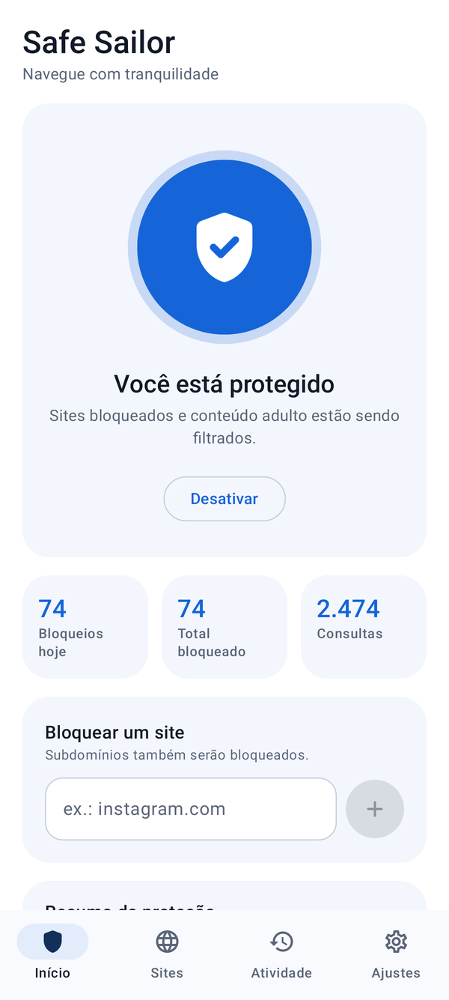
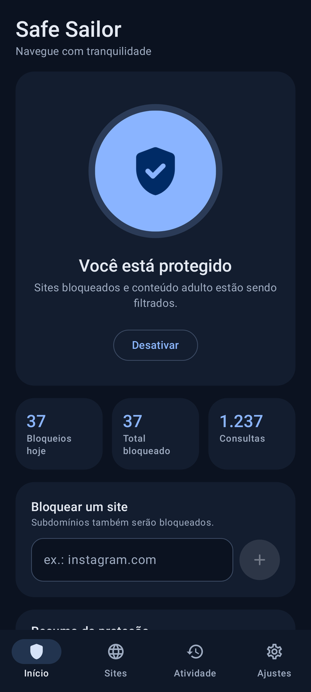
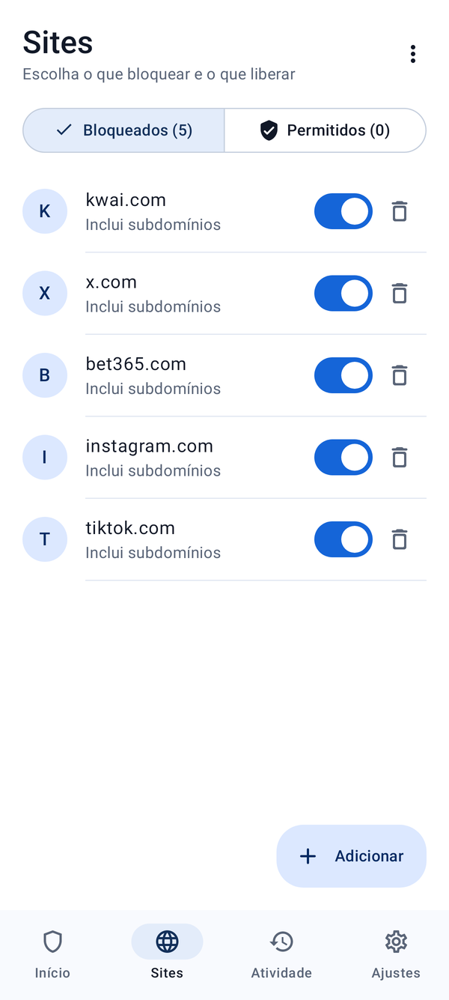
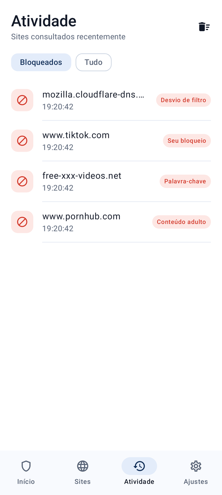
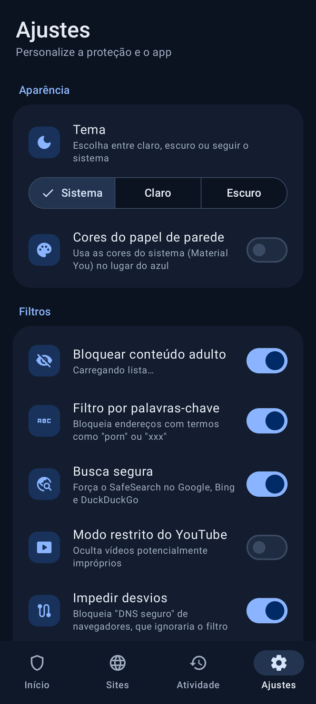

# Safe Sailor

Bloqueador de sites para Android: simples, privado e bonito. Bloqueia os sites que
você escolher e, por padrão, conteúdo pornográfico.

**[⬇️ Baixar APK (v1.0.0)](apk/SafeSailor-1.0.0.apk)** · Android 8.0 ou superior

| Início | Modo escuro | Sites | Atividade | Ajustes |
|---|---|---|---|---|
|  |  |  |  |  |

## Recursos

**Bloqueio**
- Bloqueie qualquer site digitando o endereço ou colando um link (subdomínios inclusos).
- Pacotes prontos: redes sociais, apostas, jogos online, vídeos e streaming.
- Filtro de conteúdo adulto com cerca de 77 mil sites, já embutido no app e atualizável pela internet.
- Filtro por palavras-chave ("porn", "xxx"…) para pegar sites novos.
- Busca segura forçada no Google, Bing e DuckDuckGo, mais o modo restrito do YouTube (opcional).
- "Impedir desvios": bloqueia o DNS seguro (DoH) dos navegadores, que passaria por cima do filtro.
- Lista de permitidos para liberar um site bloqueado por engano.
- Escolha do servidor DNS: Cloudflare Família (padrão), AdGuard Família, CleanBrowsing, Cloudflare, Google ou Quad9.

**Qualidade de vida**
- Modo escuro (sistema, claro ou escuro) e cores Material You opcionais.
- PIN para proteger o desligamento e qualquer ação que afrouxe a proteção (fica desbloqueado por 5 minutos depois de digitado).
- Atalho nas configurações rápidas (bloco "Safe Sailor").
- Religa sozinho ao ligar o celular e depois de atualizar o app.
- Compatível com "VPN sempre ativa" do Android.
- Tela de atividade: veja o que foi bloqueado e bloqueie ou libere com um toque.
- Estatísticas: bloqueios de hoje, total e consultas.
- Importar e exportar listas (.txt, inclusive no formato hosts).

## Como funciona

O app cria uma **VPN local** que só recebe as consultas de DNS do aparelho; o resto
do tráfego não passa por ele. Quando um endereço está bloqueado, o app responde
"domínio inexistente" e o site não abre. Os demais endereços são consultados no
servidor DNS escolhido. Nada é enviado a servidores do Safe Sailor, e o registro de
atividade fica apenas na memória do aparelho.

**Limitações:** apps com VPN própria, ou navegadores com DNS seguro configurado
manualmente, podem passar por cima do filtro. Só pode haver uma VPN ativa por vez no
Android. Para máxima proteção, defina um PIN e ative "VPN sempre ativa" e "Bloquear
conexões sem VPN" em *Configurações → Rede → VPN → Safe Sailor*.

## Compilar

Requisitos: JDK 17+ e Android SDK (plataforma 35).

```bash
./gradlew testDebugUnitTest   # testes
./gradlew assembleRelease     # APK em app/build/outputs/apk/release/
```

### Assinatura

Sem configuração extra, o APK é assinado com a chave de desenvolvimento
`keystore/safesailor-dev.jks` (senha `safesailor`). Manter a mesma chave permite
instalar versões novas por cima da antiga. Para distribuir publicamente, gere uma
chave própria e crie um `keystore.properties` (já está no `.gitignore`):

```properties
storeFile=/caminho/para/minha-chave.jks
storePassword=...
keyAlias=...
keyPassword=...
```

### Atualizar a lista adulta embutida

```bash
scripts/update_adult_list.sh
```

## Estrutura

```
app/src/main/java/com/safesailor/
├── vpn/     VpnService, análise de pacotes IP/UDP/DNS, regras de filtro, bloco rápido, boot
├── data/    configurações, listas, estatísticas, registro, lista adulta
├── ui/      Jetpack Compose: telas Início, Sites, Atividade e Ajustes
└── util/    normalização de domínios
```

## Créditos

Lista de conteúdo adulto: [StevenBlack/hosts](https://github.com/StevenBlack/hosts),
extensão "porn" (licença MIT).
